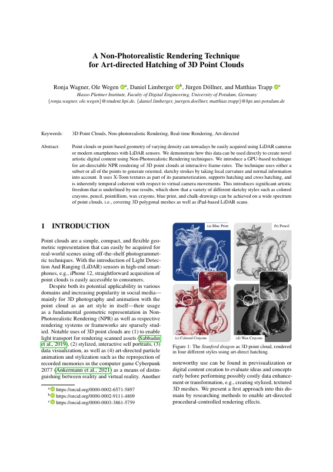
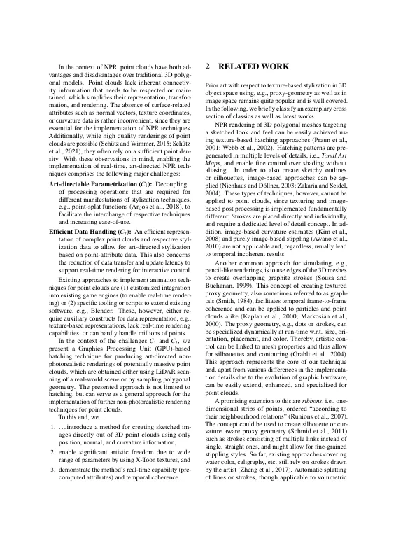
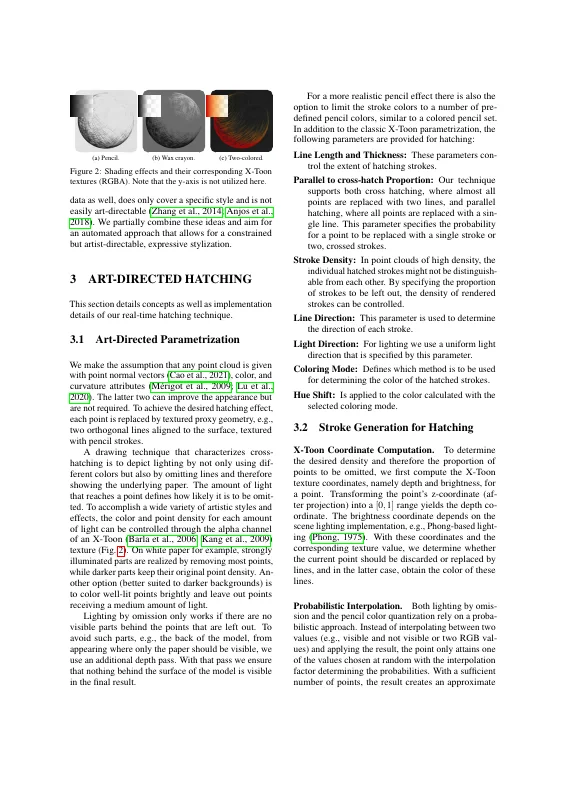
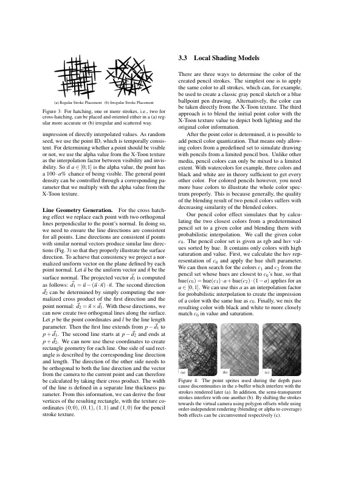
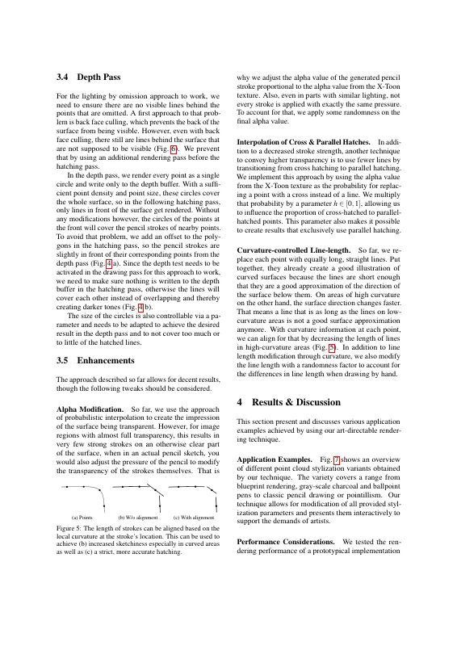
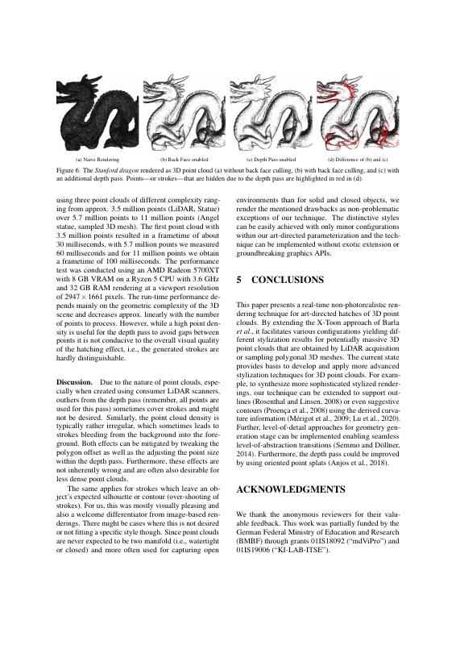
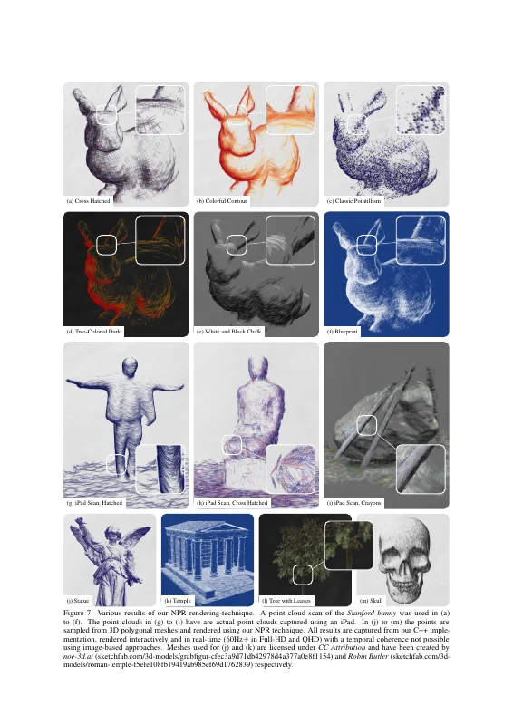
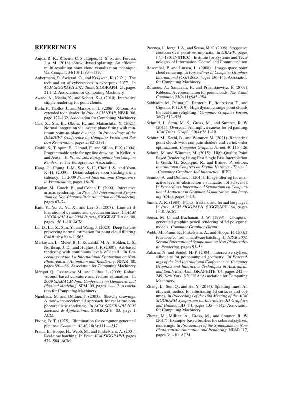

# A Non-Photorealistic Rendering Technique for Art-directed Hatching of 3D Point Clouds

[Ronja Wagner](https://orcid.org/0009-0003-9023-773X), [Ole Wegen](https://orcid.org/0000-0002-6571-5897), [Daniel Limberger](https://orcid.org/0000-0002-9111-4809), [Jürgen Döllner](https://orcid.org/0000-0002-8981-8583), and [Matthias Trapp](https://orcid.org/0000-0003-3861-5759)

*Proceedings of the 17th International Joint Conference on Computer Vision, Imaging and Computer Graphics Theory and Applications (GRAPP '22)*, February 6–8, 2022, online. SciTePress, pp. 220–227.

DOI: [10.5220/0010849500003124](https://doi.org/10.5220/0010849500003124) · Author's version: [Zenodo](https://doi.org/10.5281/zenodo.24059250) · [ResearchGate](https://www.researchgate.net/publication/358523901)

> Point clouds or point-based geometry of varying density can nowadays be easily acquired using LiDAR cameras or modern smartphones with LiDAR sensors.
> We demonstrate how this data can be used directly to create novel artistic digital content using Non-Photorealistic Rendering techniques.
> We introduce a GPU-based technique for art-directable NPR rendering of 3D point clouds at interactive frame-rates.
> The technique uses either a subset or all of the points to generate oriented, sketchy strokes by taking local curvature and normal information into account.
> It uses X-Toon textures as part of its parameterization, supports hatching and cross hatching, and is inherently temporal coherent with respect to virtual camera movements.
> This introduces significant artistic freedom that is underlined by our results, which show that a variety of different sketchy styles such as colored crayons, pencil, pointillism, wax crayons, blue print, and chalk-drawings can be achieved on a wide spectrum of point clouds, i.e., covering 3D polygonal meshes as well as iPad-based LiDAR scans.

<p><a href="wagner2022-pointcloud-stylization-as-submitted.pdf"></a> <a href="wagner2022-pointcloud-stylization-as-submitted.pdf"></a> <a href="wagner2022-pointcloud-stylization-as-submitted.pdf"></a> <a href="wagner2022-pointcloud-stylization-as-submitted.pdf"></a></p>
<details><summary>All 8 pages</summary><p><a href="wagner2022-pointcloud-stylization-as-submitted.pdf"></a> <a href="wagner2022-pointcloud-stylization-as-submitted.pdf"></a> <a href="wagner2022-pointcloud-stylization-as-submitted.pdf"></a> <a href="wagner2022-pointcloud-stylization-as-submitted.pdf"></a></p></details>

## Contents

- [`src/`](src/) – LaTeX sources of the camera-ready version (SciTePress conference template, `pdflatex` + BibTeX/`apalike`)
- [`wagner2022-pointcloud-stylization-as-submitted.pdf`](wagner2022-pointcloud-stylization-as-submitted.pdf) – camera-ready PDF as submitted to SciTePress
- [`build.sh`](build.sh) – reproducible build with TeX Live 2021 (podman or docker)
- [`preview/`](preview/) – page previews for this README

## Build

```bash
./build.sh        # → build/pc-npr.pdf
```

The SciTePress template files (`article.cls`, `SCITEPRESS.sty`, `apalike.sty`, `apalike.bst`, `orcid.eps`) are bundled in `src/` and take precedence over the system versions.
The camera-ready was built with MiKTeX (pdfTeX 1.40.23, i.e., the 2021 generation), hence the TeX Live 2021 container.
On `main`, the build produces the revised version (`v1.1-revised`). Check out `v1.0-camera-ready` to reproduce `wagner2022-pointcloud-stylization-as-submitted.pdf` (identical text, word order, and page count; pixel-level differences on two pages are negligible).

## Versions

- [`v1.0-camera-ready`](https://github.com/dl-archive/article.2022-grapp-pointcloud-stylization/tree/v1.0-camera-ready) – sources as submitted to SciTePress (2021-11-29)
- [`v1.1-revised`](https://github.com/dl-archive/article.2022-grapp-pointcloud-stylization/tree/v1.1-revised) – author's revised version (2026-11-08): grammar and reference fixes, see [Revisions](#revisions)

## Revisions

`v1.1-revised` (2026-11-08) corrects errors in the camera-ready version without changing its content or layout.
Every page carries the note "Author's revised version (2026-11-08). Version of record: https://doi.org/10.5220/0010849500003124".

- Grammar and word choice: "temporally coherent", "temporally incoherent", "art-directed hatching" (Figure 1), "procedurally controlled", "increase ease-of-use", "levels of detail", "implemented fundamentally differently; strokes are", "easily extended", "graphics hardware", "calligraphy", "only covers", "too little", "account for that", "This section presents", "as well as adjusting", "two-manifold", "we regard the mentioned drawbacks", "provides a basis", "approaches for geometry generation".
- Figure 7: "The point clouds in (g) to (i) are real-world point clouds" (was "have are actual point clouds").
- References: page ranges with broken dashes (Anjos et al., Markosian et al., Mérigot et al., Phong, Zakaria and Seidel, Zhang et al.) and "page" → "pages" (Barla et al.); author initials of Anjos et al. ("D. S.", "J. M."); "SIAM/ACM"; capitalization of NPR, 3D, Cyberpunk, Voronoi, X-Toon, and OverCoat in titles.

## Citation

```bibtex
@InProceedings{wagner2022-pointcloud-stylization,
  author    = {Wagner, Ronja and Wegen, Ole and Limberger, Daniel and D{\"o}llner, J{\"u}rgen and Trapp, Matthias},
  title     = {A Non-Photorealistic Rendering Technique for Art-directed Hatching of 3D Point Clouds},
  booktitle = {Proceedings of the 17th International Joint Conference on Computer Vision, Imaging and Computer Graphics Theory and Applications},
  year      = {2022},
  series    = {GRAPP~'22},
  publisher = {SciTePress},
  pages     = {220--227},
  doi       = {10.5220/0010849500003124},
  isbn      = {978-9-897585-55-5},
}
```
